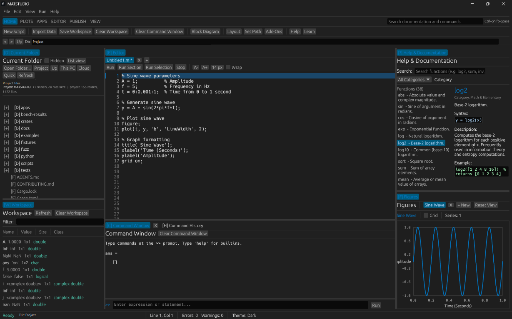

# MatRust Studio

**MATLAB-style numerical computing and App Designer tooling, built in Rust.**

[](https://github.com/varunkumar898/MatRust-Studio/actions/workflows/ci.yml)
[](LICENSE-MIT)
[](Cargo.toml)

> **Status: Alpha.** Compatibility is incomplete and behavior may change. Check the [coverage registry](docs/COVERAGE.md) before relying on a feature.

MatRust Studio is an independent, clean-room Rust workspace for numerical computing and MATLAB App Designer (`.mlapp` / `.mlappinstall`) inspection and runtime experiments. It also includes a Simulink `.slx` inspector and a simple fixed-step simulation engine.

AI features and telemetry are intentionally out of scope. The project is local-first; optional bridges can use separately installed MATLAB or GNU Octave.

## Screenshots



More gallery slots: `docs/images/editor.png`, `docs/images/simulink-inspector.png`. Add clean, privacy-reviewed captures before using those paths.

## Highlights

- MATLAB-style parser, interpreter, column-major arrays, numerical builtins, and MAT-file I/O.
- App Designer package inspection, component modeling, callback analysis, runtime, and egui desktop UI.
- Deterministic 2D plotting, a C ABI, and PyO3 Python bindings.
- Simulink `.slx` package inspection and a simple fixed-step simulation engine.
- Optional MATLAB and GNU Octave bridges; neither is required for core local use.

## Quick Start

```sh
git clone https://github.com/varunkumar898/MatRust-Studio.git
cd MatRust-Studio
cargo run --release -p rustlab-cli -- --help
```

The workspace declares Rust 1.88.0 as its MSRV. See [Contributing](CONTRIBUTING.md) for the verification commands.

## Architecture

| Area | Main crates | Responsibility |
|---|---|---|
| Numerical core | `rustlab-parse`, `rustlab-math`, `rustlab-eval`, `rustlab-stdlib`, `rustlab-data`, `rustlab-matio` | Parse and evaluate scripts, numerical values, builtins, data, and MAT files |
| App Designer | `mlapp-container`, `mlapp-ui`, `mlapp-lang`, `mlapp-runtime`, `mlapp-host` | Inspect packages, model components, analyze callbacks, and run apps |
| Desktop and plots | `mlapp-render`, `mlapp-plot`, `rustlab-plot`, `apps/desktop` | Rendering, SVG plots, and the egui application |
| Integration and simulation | `mlapp-sim`, `mlapp-cli`, `mlapp-ffi`, `mlapp-py`, `mlapp-matlab`, `mlapp-octave` | CLI, `.slx`, C/Python APIs, and optional external-runtime bridges |

## Compatibility and Safety

The current registry reports 90.0% for Tier F1, 47.5% for Tier F2, and 79.7% implemented coverage overall. These are registry figures, not a promise of full MATLAB compatibility; partial and missing entries are listed in [docs/COVERAGE.md](docs/COVERAGE.md) and the [feature matrix](docs/FEATURE-MATRIX.md).

Security boundaries, unsafe code, and limitations are documented in [docs/SAFETY-AUDIT.md](docs/SAFETY-AUDIT.md). The audit is partial, not a formal verification.

## Roadmap

Planned themes include developer diagnostics and debugging, broader simulation and MATLAB compatibility, cross-platform packaging, opt-in real-app testing, and tutorials. See [ROADMAP.md](ROADMAP.md).

## Contributing

Start with [CONTRIBUTING.md](CONTRIBUTING.md) and [docs/GOOD-FIRST-ISSUES.md](docs/GOOD-FIRST-ISSUES.md). Contributions must follow the clean-room policy; do not submit proprietary app or model files.

## Trademark Notice

> **NOTICE**: MatRust Studio and `mlapp-rs` are independent clean-room implementations developed without proprietary MathWorks code. MATLAB is a registered trademark of The MathWorks, Inc. This project is not affiliated with, sponsored by, or endorsed by The MathWorks, Inc.

## License

Licensed under either the [MIT License](LICENSE-MIT) or [Apache License 2.0](LICENSE-APACHE), at your option.
