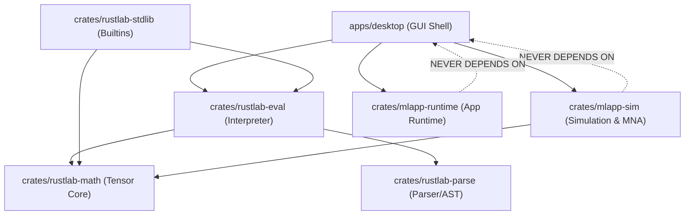

# MatRust Studio — Codebase & Repository Map

This document provides a structural map of the MatRust Studio codebase, detailing directory layouts, crate responsibilities, dependency relationships, and contributor task categories across the entire workspace.

---

## 1. Top-Level Directory Layout

```
<repo>/
├── apps/
│   └── desktop/                 # MatRust Studio desktop GUI (eframe/egui)
├── crates/
│   ├── rustlab-parse/           # MATLAB syntax lexer, parser, AST, source spans
│   ├── rustlab-math/            # N-D column-major tensor core, broadcasting, Faer linalg
│   ├── rustlab-eval/            # Tree-walking interpreter & environment management
│   ├── rustlab-stdlib/          # Standard numerical & engineering built-in library
│   ├── rustlab-data/            # Table types, summary statistics, CSV data parsing
│   ├── rustlab-matio/           # MAT-file (Level 5 / Level 7) binary serialization
│   ├── rustlab-plot/            # Declarative SVG plot-description model
│   ├── rustlab-cli/             # Interactive REPL & batch script command runner
│   ├── mlapp-container/         # MATLAB App Designer (.mlapp) package extractor
│   ├── mlapp-ui/                # App Designer visual component models & properties
│   ├── mlapp-lang/              # App Designer language binding & code reflection
│   ├── mlapp-runtime/           # Headless component state machine & callback router
│   ├── mlapp-plot/              # Specialized plot adapter for App Designer canvases
│   ├── mlapp-host/              # Host application shell & environment bridge
│   ├── mlapp-render/            # Headless screenshot & layout validation engine
│   ├── mlapp-ffi/               # C-ABI export headers & dynamic library interface
│   ├── mlapp-matlab/            # Commercial engine bridge & external validation
│   ├── mlapp-sim/               # Block diagram simulation, MNA circuit solver, C99 codegen
│   ├── mlapp-octave/            # GNU Octave subprocess oracle & parity tester
│   ├── mlapp-py/                # Python C-API bindings & NumPy bridge
│   └── mlapp-cli/               # CLI runner for .mlapp files & diagram diagnostics
├── docs/                        # Architecture, charters, specifications, roadmaps
├── examples/                    # Runnable simulation models and tutorial scripts
├── scripts/                     # CI verification, benching, and hygiene utilities
├── tests/                       # Cross-crate golden scripts, fixtures, and MAT files
├── Cargo.toml                   # Workspace manifest (22 member crates)
└── rust-toolchain.toml          # Rust toolchain declaration
```

---

## 2. Workspace Members Catalog (22 Members)

| Crate Name | Type | Primary Role & Responsibility | Key Source Paths | Direct Internal Dependencies | Key Test Paths | Contributor Task Category |
| :--- | :--- | :--- | :--- | :--- | :--- | :--- |
| **`apps/desktop`** (`matrust_studio`) | Desktop Binary & Lib | Interactive desktop GUI featuring docking panels, block diagram editor, code editor, scope window, problems panel, and file explorer. | `apps/desktop/src/main.rs`, `lib.rs`, `block_diagram_editor.rs`, `scope_view.rs` | `mlapp-sim`, `mlapp-render`, `mlapp-runtime`, `rustlab-eval`, `rustlab-math`, `rustlab-stdlib` | `apps/desktop/tests/desktop_tests.rs`, `editor_gui_tests.rs`, `gui_clean_tests.rs` | UI/UX, schematic editing, user ergonomics |
| **`crates/rustlab-parse`** | Library | Lexical analysis and Pratt recursive-descent parsing for MATLAB syntax, AST generation, and source span error tracking. | `src/lib.rs`, `lexer.rs`, `parser.rs`, `ast.rs`, `span.rs` | *None (Leaf)* | `tests/lexer_tests.rs`, `tests/parser_tests.rs`, `tests/proptest_parser.rs` | Compiler frontend, syntax extensions, error formatting |
| **`crates/rustlab-math`** | Library | Core column-major $N$-D array tensor (`DenseArray<T>`), scalar `Value` enum, broadcasting, elementary ops, and Faer matrix decompositions. | `src/lib.rs`, `array.rs`, `value.rs`, `broadcast.rs`, `ops.rs` | *None (Leaf)* | `tests/math_tests.rs`, `tests/broadcasting_tests.rs` | Numerical algorithms, tensor core, linear algebra |
| **`crates/rustlab-eval`** | Library | Tree-walking AST interpreter, lexical scope environment, call stack frame management, and runtime control flow. | `src/lib.rs`, `eval.rs`, `environment.rs`, `stack.rs` | `rustlab-parse`, `rustlab-math` | `tests/eval_tests.rs`, `tests/control_flow_tests.rs` | Interpreter runtime, closures, variable scoping |
| **`crates/rustlab-stdlib`** | Library | MATLAB standard built-in library (linear algebra, elementary math, stats, FFT, string manipulation, formatting). | `src/lib.rs`, `linalg.rs`, `elfun.rs`, `signal.rs`, `strings.rs` | `rustlab-math`, `rustlab-eval`, `rustlab-matio` | `tests/stdlib_tests.rs`, `tests/stdlib_a1_tests.rs`, `tests/stdlib_a2_tests.rs`, `tests/stdlib_a3_tests.rs` | Built-in functions, numerical oracles, documentation |
| **`crates/rustlab-data`** | Library | Data analysis tools including tabular data representations (`Table`), column metadata, RFC 4180 CSV parsing, and summary statistics. | `src/lib.rs`, `table.rs`, `csv.rs`, `stats.rs` | `rustlab-math` | `tests/data_tests.rs`, `tests/csv_tests.rs` | Data engineering, file formats, table operations |
| **`crates/rustlab-matio`** | Library | Binary MAT-file format reader and writer supporting Level 5 and Level 7 compressed archives without external C dependencies. | `src/lib.rs`, `reader.rs`, `writer.rs`, `level5.rs` | `rustlab-math` | `tests/matio_tests.rs`, `tests/mat_v7_tests.rs` | Binary serialization, compression, file compatibility |
| **`crates/rustlab-plot`** | Library | Deterministic SVG plot-description model (Figure, Axes, Line, Scatter, Bar) with stable element IDs and nice tick formatting. | `src/lib.rs`, `figure.rs`, `axes.rs`, `svg_renderer.rs` | `rustlab-math` | `tests/plot_tests.rs`, `tests/svg_snapshot_tests.rs` | Visualization, SVG rendering, plot styling |
| **`crates/rustlab-cli`** | Binary & Lib | Interactive REPL shell with syntax highlighting, multiline editing, history persistence, and batch script execution. | `src/main.rs`, `lib.rs`, `repl.rs`, `highlight.rs` | `rustlab-parse`, `rustlab-eval`, `rustlab-math`, `rustlab-stdlib` | `tests/cli_tests.rs` | Terminal interface, REPL ergonomics, command line |
| **`crates/mlapp-sim`** | Library | Multi-domain simulation engine: block diagram model, continuous/discrete solvers (Euler, RK4, DP45), MNA circuit solver, and C99 codegen. | `src/lib.rs`, `model.rs`, `engine.rs`, `solver.rs`, `electrical.rs`, `codegen.rs`, `sweep.rs` | *None (Leaf simulation core)* | `tests/sim_tests.rs`, `tests/solver_tests.rs`, `tests/m4_electrical_tests.rs`, `tests/m5_mna_tests.rs`, `tests/codegen_tests.rs` | Solvers, physical components, code generation |
| **`crates/mlapp-container`**| Library | Inspection, extraction, and validation of MATLAB App Designer archive packages (`.mlapp`), XML parsing, and ZIP slip guards. | `src/lib.rs`, `package.rs`, `manifest.rs` | *None (Leaf)* | `tests/container_tests.rs`, `tests/zip_guard_tests.rs` | Archive parsing, security validation |
| **`crates/mlapp-ui`** | Library | App Designer component hierarchy model (Buttons, Sliders, Gauges, Axes, Panels) and layout property definitions. | `src/lib.rs`, `component.rs`, `properties.rs` | `mlapp-container` | `tests/ui_model_tests.rs` | UI components, property models |
| **`crates/mlapp-lang`** | Library | Code reflection, callback binding extraction, and syntax analysis for App Designer script codebehind files. | `src/lib.rs`, `callbacks.rs`, `reflection.rs` | `mlapp-container`, `rustlab-parse` | `tests/lang_tests.rs` | Callback dispatch, AST analysis |
| **`crates/mlapp-runtime`** | Library | Headless component state machine, property binding synchronization, event queues, and callback execution. | `src/lib.rs`, `session.rs`, `state.rs`, `dispatcher.rs` | `mlapp-container`, `mlapp-ui`, `mlapp-lang`, `rustlab-eval` | `tests/runtime_tests.rs` | State management, event handling |
| **`crates/mlapp-plot`** | Library | Canvas plotting bridge connecting App Designer UIAxes components with the RustLab graphics subsystem. | `src/lib.rs`, `bridge.rs`, `canvas.rs` | `mlapp-ui`, `rustlab-plot`, `rustlab-math` | `tests/plot_bridge_tests.rs` | Plotting bridges, graphics canvas |
| **`crates/mlapp-host`** | Library | Host application abstraction shell, cross-thread event pump, window event management, and runtime lifecycle. | `src/lib.rs`, `host.rs`, `lifecycle.rs` | `mlapp-runtime` | `tests/host_tests.rs` | System integration, thread management |
| **`crates/mlapp-render`** | Library | Headless rendering and rasterization engine for layout verification, visual regression testing, and PNG/SVG export. | `src/lib.rs`, `headless.rs`, `raster.rs` | `mlapp-ui`, `mlapp-runtime`, `mlapp-host` | `tests/render_tests.rs` | Headless rendering, visual regression |
| **`crates/mlapp-ffi`** | Library (cdylib/rlib) | C-compatible Foreign Function Interface (FFI) exporting C-ABI handles for embedding the engine in external hosts. | `src/lib.rs`, `c_api.rs`, `handles.rs` | `mlapp-runtime`, `mlapp-host` | `tests/ffi_tests.rs` | Language bindings, C-ABI stability |
| **`crates/mlapp-matlab`** | Library | External commercial MATLAB validation bridge for running headless comparative test oracles in environments with licensed installations. | `src/lib.rs`, `bridge.rs` | *Optional external bridge* | `tests/matlab_oracle_tests.rs` | External validation, regression testing |
| **`crates/mlapp-octave`** | Library | GNU Octave subprocess driver and parity oracle tester for automated numerical and language compliance checking. | `src/lib.rs`, `octave_runner.rs` | `rustlab-math` | `tests/octave_parity_tests.rs` | Conformance testing, parity oracles |
| **`crates/mlapp-py`** | Library | Python C-API bindings and PyO3/NumPy integration bridge for embedding MatRust Studio in Python scripts. | `src/lib.rs`, `python_bridge.rs` | `rustlab-math` | `tests/py_tests.rs` | Python ecosystem interoperability |
| **`crates/mlapp-cli`** | Binary | Command-line utility for inspecting `.mlapp` packages, running headless simulation diagrams, and checking diagnostic models. | `src/main.rs`, `cli.rs` | `mlapp-container`, `mlapp-runtime`, `mlapp-sim` | `tests/cli_tests.rs` | CLI tooling, automated diagnostics |

---

## 3. Strict Dependency Boundaries & Invariants



### Architectural Guardrails
1. **Simulation Engine Independence**: `mlapp-sim` is a completely headless, standalone library. It never depends on `apps/desktop`, `eframe`, or `egui`. All simulation models, ODE solvers, MNA algorithms, and C code generators run headlessly.
2. **Language Runtime Decoupling**: `rustlab-math` and `rustlab-parse` are pure leaf crates without dependencies on interpreter state, I/O, or GUI libraries.
3. **No Circular Dependencies**: Cargo strictly enforces a directed acyclic graph (DAG) across all 22 workspace crates.
