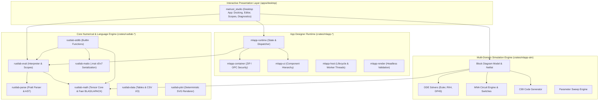
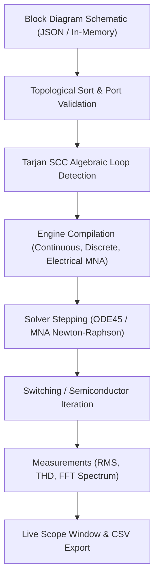
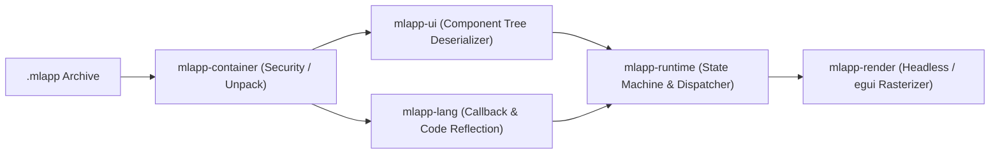

# MatRust Studio — System Architecture & Implementation Specification

This document specifies the software architecture, crate boundaries, data flow pipelines, dependency invariants, and technical tradeoffs implemented in **MatRust Studio**.

---

## 1. System Overview & Layered Architecture

MatRust Studio is composed of four principal architectural subsystems organized into a 22-crate Cargo workspace:
1. **Core Numerical & Language Subsystem (`rustlab-*`)**: Clean-room MATLAB-compatible syntax parser, tree-walking interpreter, column-major multidimensional tensor core, and standard mathematical library.
2. **App Designer Subsystem (`mlapp-*`)**: Container archive inspector, XML component parser, callback router, and headless/GUI rendering engine for `.mlapp` packages.
3. **Multi-Domain Simulation Subsystem (`mlapp-sim`)**: Graphical block-diagram compiler, continuous/discrete ODE solvers, Ho-Ruehli-Brennan Modified Nodal Analysis (MNA) electrical network engine, semiconductor switching solver, and ISO C99 code generator.
4. **Desktop GUI Shell (`apps/desktop`)**: Cross-platform interactive workbench powered by `egui`/`eframe`, providing schematic schematic editing, live scopes, docking panels, code editing, and diagnostic views.

---

## 2. Workspace Crates & Responsibilities

The 22 workspace crates are partitioned by strict separation of concerns:

### 2.1 Core Numerical Crates
- **`crates/rustlab-parse`**: Lexical analysis and Pratt recursive-descent parser. Handles whitespace-sensitive matrix constructors (`[1 - 2]` vs `[1 -2]`), quote disambiguation (string literal vs conjugate transpose `A'`), 12 operator precedence levels, and right-associative exponentiation (`A.^B.^C`). Generates AST with byte-accurate `Span` locations.
- **`crates/rustlab-math`**: Foundational value model (`Value`), multidimensional tensor storage (`DenseArray<T>`), strided column-major ordering, broadcasting (implicit dimension expansion), and linear algebra routines integrated with `faer`.
- **`crates/rustlab-eval`**: Tree-walking AST evaluator managing lexical scopes (`Environment`), global/persistent symbols, call stacks (`CallStack`), and multi-argument assignment destructuring (`[a, b] = func()`).
- **`crates/rustlab-stdlib`**: Builtin numerical standard library spanning elementary arithmetic (`elfun`), linear algebra (`linalg`), reduction/statistics (`stats`), fast Fourier transforms (`signal`), and string formatting (`sprintf`/`fprintf`).
- **`crates/rustlab-data`**: Tabular data structure (`Table`) supporting mixed-type columns, row/column slicing, summary statistics, and RFC 4180 CSV parsing.
- **`crates/rustlab-matio`**: Level 5 and Level 7 MAT-file binary deserialization and compression engine without external C libraries.
- **`crates/rustlab-plot`**: Pure-Rust declarative SVG plot-description model (`Figure`, `Axes`, `Line`, `Scatter`, `Bar`) with deterministic coordinate formatting and nice tick calculations.
- **`crates/rustlab-cli`**: Interactive REPL shell with syntax highlighting, multiline navigation, command history, and batch script runner.

### 2.2 App Designer Runtime Crates
- **`crates/mlapp-container`**: OPC/ZIP container parsing with defenses against zip-slip and zip-bomb attacks.
- **`crates/mlapp-ui`**: Quick-XML component hierarchy deserializer mapping MATLAB bottom-left coordinate systems to top-left screen spaces.
- **`crates/mlapp-lang`**: Code reflection and callback linkage extraction for App Designer scripts.
- **`crates/mlapp-runtime`**: Component state machine, property bindings, event queues, and callback dispatching.
- **`crates/mlapp-plot`**: Graphics adapter connecting App Designer UIAxes with the plotting engine.
- **`crates/mlapp-host`**: Worker thread management, cross-thread event queues, and cancellation tokens.
- **`crates/mlapp-render`**: Headless rasterization engine for layout verification and automated screenshot comparison.
- **`crates/mlapp-ffi`**: Stable C-ABI header and shared library interfaces (`mlapp.h`).
- **`crates/mlapp-cli`**: Command-line interface for inspecting `.mlapp` packages and running diagnostic checks.

### 2.3 Multi-Domain Simulation Crates
- **`crates/mlapp-sim`**: Standalone simulation core encompassing:
  - Block diagram data model (`BlockDiagram`, `Block`, `Wire`, `Port`, `BlockType`).
  - Topological graph compilation, sort, and Tarjan SCC algebraic loop detection.
  - Continuous ODE integrators: Forward Euler, 4th-Order Runge-Kutta (RK4), and adaptive Dormand-Prince (DP45) with FSAL.
  - Ho-Ruehli-Brennan Modified Nodal Analysis (MNA) circuit solver with Dommel companion models.
  - Piecewise-linear semiconductor switching models with within-step iteration and limit cycle detection (`W-CHATTER`, `E-CHATTER`).
  - Continuous-to-electrical sensor transducers and controlled sources (VCVS, VCCS).
  - True RMS, Mean, Power, THD, and FFT measurements.
  - ANSI/ISO C99 allocation-free code generator and GCC compilation harness.
  - Multi-dimensional parameter sensitivity sweeps.

### 2.4 Desktop Application
- **`apps/desktop`** (`matrust_studio`): Graphical shell providing docking panels, schematic canvas editor with snap-to-grid, Manhattan wire routing, multi-selection, alignment, zoom-to-fit, interactive scopes, problems modal, and file explorer.

---

## 3. Strict Dependency Boundaries & Architectural Invariants

### 3.1 Unidirectional Dependency Invariant
Dependencies flow strictly downward from presentation to engine:
$$\text{apps/desktop} \longrightarrow \text{crates/mlapp-sim} \longrightarrow \text{crates/rustlab-math}$$
$$\text{apps/desktop} \longrightarrow \text{crates/mlapp-runtime} \longrightarrow \text{crates/rustlab-eval} \longrightarrow \text{crates/rustlab-parse}$$

### 3.2 Forbidden Dependencies
1. **Simulation Engine Headless Rule**: `crates/mlapp-sim` must **never** depend on `apps/desktop`, `egui`, `eframe`, or any GUI library. All solvers, circuit analysis, and code generators must execute in headless CLI and CI environments.
2. **Core Math Leaf Rule**: `crates/rustlab-math` and `crates/rustlab-parse` must **never** depend on interpreter state, I/O libraries, or simulation models.
3. **Circular Dependencies**: Prohibited across all crates; Cargo enforces a strict DAG.

---

## 4. Key Execution Pipelines

### 4.1 Numerical Execution Pipeline

### 4.2 Multi-Domain Simulation Pipeline

### 4.3 App Designer Runtime Pipeline

---

## 5. Technical Tradeoffs & Justifications

### 5.1 Column-Major DenseArray vs Row-Major
- **Decision**: Native column-major (Fortran order) multidimensional arrays.
- **Justification**: MATLAB semantics require column-first memory iteration ($A(:)$ unrolls down columns). Utilizing row-major formats (like standard `ndarray`) would introduce constant copy overhead on linear algebra operations and sliced submatrices.

### 5.2 Hand-Written Pratt Parser vs Parser Combinators
- **Decision**: Hand-written recursive descent with Pratt expression parsing.
- **Justification**: MATLAB syntax contains context-sensitive whitespace rules (e.g. `[1 - 2]` is $[-1]$, but `[1 -2]` is $[1, -2]$) and ambiguous character roles (`'` as transpose vs quote). Standard grammar tools fail without complex lexical hacks.

### 5.3 Pure-Rust Linear Algebra (`faer`) vs C BLAS/LAPACK
- **Decision**: `faer` for matrix factorizations (LU, QR, SVD, Cholesky, Eig).
- **Justification**: Eliminates external Fortran/C toolchain requirements (OpenBLAS, Intel MKL), allowing seamless cross-compilation across Windows ARM64, Linux, and WebAssembly while providing state-of-the-art SIMD performance.

### 5.4 Standalone Modified Nodal Analysis (MNA) Engine
- **Decision**: Fully integrated companion-model MNA formulation within `mlapp-sim`.
- **Justification**: Allows unified time-stepping between continuous ODE control blocks and non-linear electrical circuits without multi-process IPC latency.

---

## 6. Extension Points & Roadmap Integration

- **Phase F1–F2**: Graphical schematic editor features and extended block library (buses, state-space, lookups).
- **Phase F3–F4**: Subsystem hierarchy flattening and stiff numerical solvers (Radau IIA, BDF, index-1 DAEs).
- **Phase F5**: Multi-domain physical simulation (mechanical shafts/springs, thermal RC networks, hydraulic flow).
- **Phase F6–F10**: Statecharts, Data Inspector, control design tools (Bode, Nyquist, root locus), and automated testing managers.
- **Phase F11–F13**: Embedded C/C++ target deployment, external FMI/FMU co-simulation, and multi-core parallel scaling.
