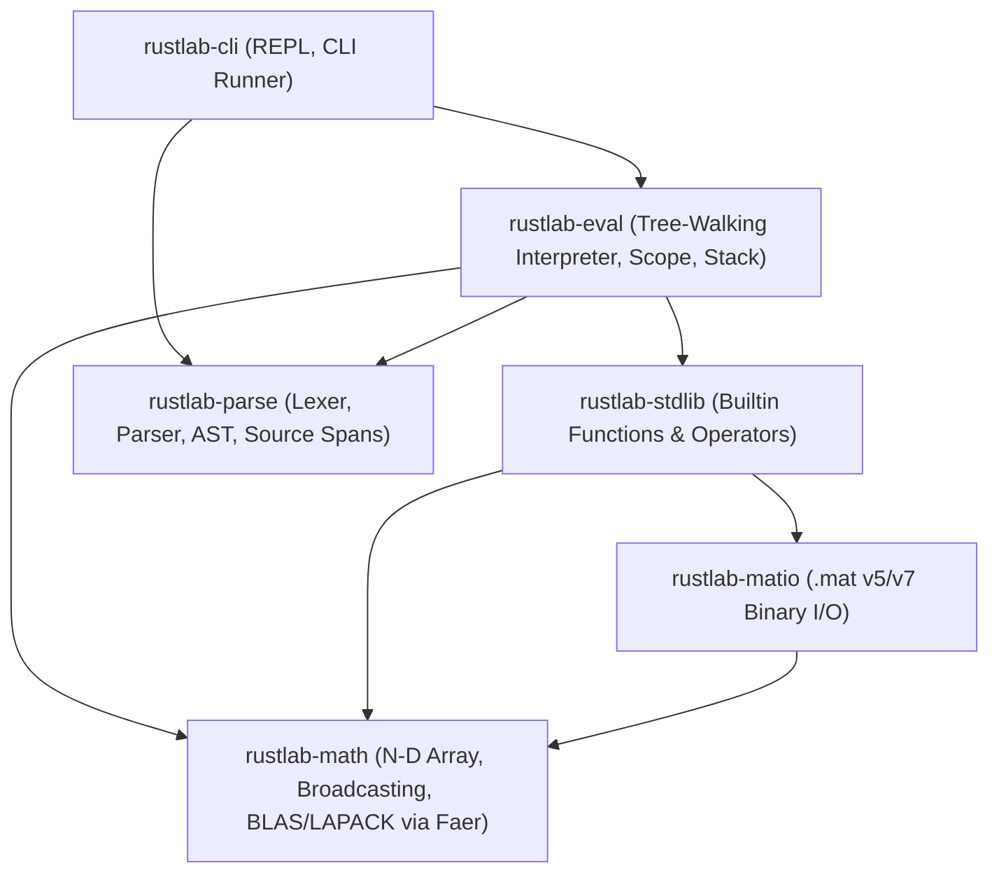

# RustLab Architecture Proposal & Cargo Workspace Design

This document specifies the software architecture, crate boundaries, data flow, and technical justifications for `rustlab`.

---

## 1. System Architecture & Crate Dependency Graph



---

## 2. Proposed Cargo Workspace Crates

The project is partitioned into six modular, single-responsibility crates within a Cargo workspace:

### 2.1 `rustlab-parse` (Lexer, Parser, AST)
- **Role**: Tokenizes raw MATLAB source code and constructs a strongly typed Abstract Syntax Tree (AST) with source span tracking (`miette` / `ariadne` diagnostic integration).
- **Key Types**:
  - `Token`, `TokenKind`, `Span`
  - `Expr`, `Stmt`, `FunctionDef`, `BinaryOp`, `UnaryOp`, `AssignTarget`
- **Dependencies**: `logos` (for ultra-fast tokenization) or hand-written lexer, `thiserror`.

### 2.2 `rustlab-math` (Numeric Core & $N$-D Array)
- **Role**: Foundational value model, column-major multidimensional tensor storage, implicit expansion (broadcasting) engine, and linear algebra routines.
- **Key Types**:
  - `Value`: Enum representing any MATLAB data type (`Double`, `Single`, `Int32`, `Logical`, `Char`, `String`, `Cell`, `Struct`).
  - `DenseArray<T>`: Pure column-major strided array with dynamic shape `Vec<usize>`.
  - `Complex<T>`: Real and imaginary arithmetic.
  - `BroadcastIter`: Zero-copy broadcasting coordinate generator.
- **Dependencies**: `faer` (pure-Rust state-of-the-art BLAS/LAPACK matrix decompositions), `num-complex`, `num-traits`, `thiserror`.

### 2.3 `rustlab-eval` (Interpreter & Runtime Engine)
- **Role**: Evaluates the AST, manages lexical environments, global/persistent state, function call stacks, multi-argument assignments (`[a, b] = func()`), and dynamic indexing.
- **Key Types**:
  - `Environment`: Symbol table mapping identifiers to `Value`.
  - `CallStack`, `StackFrame`: Call history for stack traces and `nargin`/`nargout` tracking.
  - `Interpreter`: Core evaluator method `eval_stmt(&mut self, stmt: &Stmt) -> Result<EvalResult, RustLabError>`.
- **Dependencies**: `rustlab-parse`, `rustlab-math`, `rustlab-stdlib`, `thiserror`.

### 2.4 `rustlab-stdlib` (Builtin Function Library)
- **Role**: Implements the top 100 MATLAB standard functions registered via a unified trait.
- **Key Abstraction**:
  ```rust
  pub trait BuiltinFunction: Send + Sync {
      fn name(&self) -> &'static str;
      fn call(
          &self,
          args: Vec<Value>,
          nargout: usize,
      ) -> Result<Vec<Value>, RustLabError>;
  }
  ```
- Modularized into submodules: `linalg`, `stats`, `elfun`, `creation`, `shapes`, `io`.

### 2.5 `rustlab-matio` (MAT-File Binary Storage)
- **Role**: Reads and writes Level 5 / Level 7 compressed `.mat` files without external C libraries.
- **Dependencies**: `rustlab-math`, `flate2` (pure-Rust zlib compression), `byteorder`, `thiserror`.

### 2.6 `rustlab-cli` (Interactive REPL & CLI Runner)
- **Role**: Interactive command prompt (REPL) with syntax highlighting, multiline editing, history, and batch script execution.
- **Dependencies**: `rustyline`, `colored`, `clap` (CLI argument parsing).

---

## 3. Critical Technical Tradeoffs & Justifications

### 3.1 Parser Architecture: Hand-Written Recursive Descent vs. Parser Combinators (Chumsky / Pest)
- **Decision**: **Hand-Written Recursive Descent with Pratt Parsing for Expressions**.
- **Justification**:
  1. **Whitespace Sensitivity in Matrix Literals**: In MATLAB, `[1 - 2]` is a $1 \times 1$ matrix with value `[-1]`, whereas `[1 -2]` is a $1 \times 2$ matrix with values `[1, -2]`. Standard grammar tools (like Pest or Chumsky) struggle with whitespace being significant only inside bracketed matrix constructors.
  2. **Quote Disambiguation**: The character `'` can be either the start of a character literal (`'string'`) or a conjugate transpose operator (`A'`). This requires contextual lexer state tracking based on preceding tokens.
  3. **Expression Power**: A hand-written Pratt parser provides exact, tunable control over MATLAB's 12-level operator precedence table and right-to-left power associativity (`A.^B.^C`).

### 3.2 Linear Algebra Backend: `faer` vs. `ndarray` / `nalgebra`
- **Decision**: **`faer` + Custom Column-Major `DenseArray<T>`**.
- **Justification**:
  1. **Memory Ordering**: `ndarray` defaults to row-major (C-order). MATLAB is strictly **column-major** (Fortran-order). Using `ndarray` requires constant transpose operations or custom strides.
  2. **Decompositions without C/Fortran Dependencies**: `ndarray-linalg` requires dynamic linking against external OpenBLAS, Intel MKL, or LAPACK C/Fortran libraries, causing cross-platform compilation headaches on Windows, ARM64, and WebAssembly.
  3. **Performance**: `faer` is written in 100% safe/sound Rust, supports native multithreading, and outperforms OpenBLAS on modern CPUs across LU, QR, Cholesky, SVD, and linear solves ($A \setminus b$).

### 3.3 Interpreter Architecture: Tree-Walking vs. Bytecode VM
- **Decision**: **Phase 1–2 Tree-Walking, Abstracted for Bytecode Compilation**.
- **Justification**:
  - Tree-walking provides immediate transparency, readable AST node evaluation, straightforward stack trace generation, and rapid iteration during language feature development.
  - The AST and `Value` types will be decoupled from the interpreter loop so a bytecode compiler and register VM can be added cleanly as an optimization pass in later milestones.
