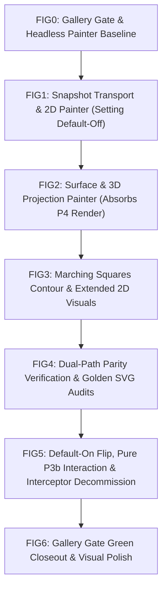

# FIG Implementation Plan: Unified Plot Engine & Desktop Painter (PLAN-FIG)

This document specifies the staged task breakdown to unify MatRust Studio's desktop plotting interface with `rustlab_plot::Figure` as defined in [ADR 0003](../adr/0003-single-plot-engine.md).

---

## 1. Task Dependency Graph & Staging Overview

---

## 2. Staged Task Specifications

### FIG0: Desktop Gallery Gate & Headless Smoke Test
- **Goal**: Create an automated test harness that executes all Math Gallery and repository examples through the headless desktop execution session and asserts figure creation and non-empty painting.
- **Initial State**: Starts **RED** for the 14 Math Gallery scripts that currently produce 0 items in the GUI (e.g., `calc-helmholtz`, `calc-laplacian`, `calc-vortex-curl`, `calc-quadrature`, `ode-lorenz`, `fractal-mandelbrot`, `fractal-julia`, `signal-spectrogram`, etc.).
- **Deliverables**:
  - `apps/desktop/tests/gallery_desktop_gate_tests.rs`:
    - `test_gallery_headless_execution_produces_figures`: runs each gallery example through `Session::exec()` and records figure/axes/series counts.
    - `test_egui_context_headless_smoke_shapes`: invokes `FiguresPanel::show` inside an offscreen `egui::Context::run()` and counts tessellated shapes produced by the painter.
- **Touch List**: `apps/desktop/tests/gallery_desktop_gate_tests.rs`, `Cargo.toml`.
- **Tests**: `cargo test -p matrust_studio --test gallery_desktop_gate_tests`.
- **Budget & Performance**: Headless evaluation of all 24 gallery scripts $\le 12.0\text{ s}$ total.
- **Risk**: None (purely additive test suite).

---

### FIG1: Snapshot Transport & 2D Series Painter (Behind Feature Setting)
- **Goal**: Transport `rustlab_plot::Figure` snapshots from the background worker thread to the GUI thread, and implement a robust 2D painter for `Line`, `Scatter`, `Bar`, and `Histogram` supporting NaN pen-up breaks, log scales, and legend boxes.
- **Scope & Details**:
  - Add `figures: HashMap<usize, Arc<rustlab_plot::Figure>>` to `WorkerResponse::ExecutionFinished`.
  - Add user setting in `apps/desktop/src/theme.rs` or `app.rs`: `use_unified_plot_engine: bool` (default `false` for safety).
  - In `apps/desktop/src/figures.rs`, implement `UnifiedFiguresPainter`:
    - Correctly renders `Series::Line` with NaN pen-up handling (required for `quiver` shafts and arrow heads).
    - Supports log-scaled coordinates for `semilogx`, `semilogy`, and `loglog`.
    - Draws axes legend box with matching line/marker swatches.
- **Touch List**:
  - `crates/rustlab-plot/src/lib.rs` (ensure required getters are `pub`).
  - `apps/desktop/src/execution.rs` (pack snapshot into `WorkerResponse`).
  - `apps/desktop/src/app.rs` (receive snapshot into `App`).
  - `apps/desktop/src/figures.rs` (new painter behind setting).
- **Tests**:
  - `apps/desktop/tests/snapshot_transport_tests.rs`: verifies thread-to-thread `Arc<Figure>` delivery.
  - `apps/desktop/tests/painter_2d_tests.rs`: verifies NaN pen-up splitting, log-scale projection, and legend geometry.
- **Budget & Performance**:
  - 100,000 line points rendered in egui under 16 ms (60 FPS interactive budget).
  - Allocation: Zero per-frame cloning; borrowed directly from `Arc<Figure>`.
- **Storage Impact**: $\le 10\text{ KB}$ added source code; 0 binary size regression.
- **Risk to Existing Behavior**: Zero risk to existing tabs while flag is default `false`.

---

### FIG2: Surface & 3D Projection Painter (Absorbs P4 Rendering)
- **Goal**: Move 3D projection, depth sorting, and camera calculations from `rustlab-plot::svg.rs` into shared public functions in `rustlab-plot`, and implement egui painter for `Surface` and `Line3D`.
- **Scope & Details**:
  - Extract `project3d`, camera azimuth/elevation rotation, and quad mesh decomposition from `crates/rustlab-plot/src/svg.rs` into `crates/rustlab-plot/src/projection.rs` (public within workspace, no duplicate logic).
  - Implement 3D painter in `apps/desktop/src/figures.rs`:
    - Quad mesh painter with painter's depth-sort for `surf` and `mesh`.
    - Projected 3D polylines for `plot3` (e.g. `ode-lorenz`).
    - Colormap color lookup (shared perceptual colormaps).
    - Mouse orbit (right-drag rotates camera azimuth and elevation).
- **Touch List**:
  - `crates/rustlab-plot/src/projection.rs` (new shared module).
  - `crates/rustlab-plot/src/svg.rs` (refactor to use `projection.rs`).
  - `apps/desktop/src/figures.rs` (surface and 3D painter).
- **Tests**:
  - `crates/rustlab-plot/tests/snapshot_tests.rs`: all existing golden SVGs must remain byte-identical.
  - `apps/desktop/tests/painter_3d_tests.rs`: quad depth order, camera rotation invariance.
- **Budget & Performance**:
  - 100×100 surface ($10^4$ quads): projection and depth-sorting under 8 ms on modern ARM64/x86_64.
- **Storage Impact**: ~15 KB source code.
- **Risk**: Verifying that `svg.rs` refactoring causes 0 byte diff in golden SVG outputs.

---

### FIG3: Marching Squares Contour Engine & Extended 2D Visuals
- **Goal**: Implement standard Marching Squares isoline extraction and filled contour polygons, plus specialized 2D plot decorators (`stem`, `polar`, `area`, `fill`, `quiver` scaling, `comet`).
- **Scope & Details**:
  - Create `crates/rustlab-plot/src/contour.rs` implementing standard textbook Marching Squares isoline tracking:
    - Provenance documented in `crates/rustlab-plot/src/contour.rs` (Lorensen & Cline / Bourke algorithm reference).
    - Generates contour line paths and contour labels at fixed intervals.
  - Update `crates/rustlab-stdlib/src/plot_builtins.rs`: `contour_fn` and `contourf_fn` emit actual contour series lines instead of falling back to `surf_fn`.
  - Add arrow head scaling parameters to `quiver_fn`.
  - Add stem base-line and round marker heads to `stem_fn`.
  - Add closed polygon fill to `area_fn` and `fill_fn`.
- **Touch List**:
  - `crates/rustlab-plot/src/contour.rs` (new module).
  - `crates/rustlab-plot/src/lib.rs` (export contour types).
  - `crates/rustlab-stdlib/src/plot_builtins.rs` (`contour`, `contourf`, `quiver`, `stem`, `area`).
  - `crates/rustlab-plot/src/svg.rs` (SVG rendering for contour lines).
- **Tests**:
  - `crates/rustlab-plot/tests/contour_algorithm_tests.rs`: golden isoline coordinates for saddle, peak, and linear gradient grids.
  - Golden SVG snapshot for `contour([0 1; 1 0])`.
- **Budget & Performance**:
  - 200×200 grid contour extraction $\le 5\text{ ms}$.
- **Storage Impact**: ~20 KB source code.
- **Risk**: Maintaining backward compatibility with `surf` camera angles if `contour` changes from surface to isoline series.

---

### FIG4: Dual-Path Parity Verification & Golden SVG Audits
- **Goal**: Rigorous parity test suite ensuring the unified model and SVG renderer match on all counts.
- **Scope & Details**:
  - Execute a comprehensive matrix of test scripts (every builtin across single and multiple subplots).
  - Assert that across both headless and GUI-view paths:
    - Figure count is identical.
    - Axes count and subplot grid coordinates `(m, n, p)` are identical.
    - Total series count and series data lengths match.
    - Title, xlabel, ylabel, zlabel, and grid states match.
    - Golden SVGs in `crates/rustlab-plot/tests/snapshots/*.svg` remain 100% byte-for-byte identical.
- **Touch List**: `crates/rustlab-plot/tests/`, `crates/rustlab-stdlib/tests/`, `apps/desktop/tests/`.
- **Tests**: `cargo test --workspace`.
- **Budget**: CI run time within normal thresholds.
- **Risk**: None (verification only).

---

### FIG5: Default Switch, P3b Pure Interaction & Interceptor Decommission
- **Goal**: Switch the default to the unified plot painter, wire up pure interaction math (P3b), and delete duplicate builtins in `execution.rs`.
- **Scope & Details**:
  - Flip default `use_unified_plot_engine = true`.
  - Delete GUI interceptors in `apps/desktop/src/execution.rs` (`plot`, `scatter`, `bar`, `figure`, `hold`, `subplot`, `title`, `xlabel`, `ylabel`, `grid`, `clf`, `cla`, `close`).
  - Connect P3 interaction math from `rustlab-plot`:
    - Pointer hit-testing via `Figure::hit_test_axes`.
    - Mouse wheel zoom centered on cursor via `Figure::zoom_subplot`.
    - Drag-pan via `Figure::pan_subplot`.
    - Linked axes synchronization (zooming/panning linked subplots moves linked axes).
    - Shift/Ctrl axis-constrained zoom.
    - Double-click and "Reset View" button restores view state.
- **Touch List**:
  - `apps/desktop/src/execution.rs` (delete ~300 lines of duplicate builtins).
  - `apps/desktop/src/figures.rs` (wire P3 interaction handlers).
- **Tests**:
  - `apps/desktop/tests/desktop_tests.rs`: adapt tests that inspected `GraphicsState` to inspect unified figure state.
  - Interactive event unit tests for wheel zoom, drag pan, and linked axes.
- **Budget & Performance**: Interaction latency $\le 16\text{ ms}$ (smooth 60 FPS under continuous dragging).
- **Risk & Mitigation**:
  - *Risk*: Breaking existing figure tabs or subplot switching.
  - *Mitigation*: The unified model already tracks `Figure.id`, `Figure.title`, and `Axes.position: (m, n, p)`. Existing tests `test_s4_scenario1_plot_twice...` through `test_s4_scenario4...` will run against the unified state to guarantee zero regression.

---

### FIG6: Gallery Gate Green Closeout & Visual Polish
- **Goal**: Re-run the FIG0 gallery gate; verify that all 24 Math Gallery examples render visual figures; capture screenshots for documentation.
- **Scope & Details**:
  - Run `gallery_desktop_gate_tests`: all 24 gallery examples must pass with `total_series > 0` and non-zero painted canvas primitives.
  - "Helmholtz Potential & Vector Gradient" displays contours, quiver field arrows, legend, and title.
  - Capture clean visual proof artifacts for `docs/gallery/`.
- **Touch List**: `docs/gallery/`, `docs/STATE.md`, `docs/WORKPLAN.md`.
- **Tests**: `cargo test -p matrust_studio --test gallery_desktop_gate_tests` (100% green).

---

## 3. Workplan Reconciliation Summary

| Workplan Code | Original Goal | Status in Plan | Absorbed By |
| :--- | :--- | :--- | :--- |
| **P1** | Subplot rendering in `rustlab-plot` | Already implemented in engine (`Axes.position`) | Integrated into GUI painter in **FIG1** |
| **P2** | Independent axes properties | Already implemented in engine (`rustlab-plot::Axes`) | Integrated into GUI painter in **FIG1** |
| **P3 / P3b** | Per-subplot interaction (hit-test, zoom, pan, linked axes) | Model math exists; desktop GUI was disconnected | Fully wired to GUI canvas in **FIG5** |
| **P4** | 3D plotting (surf, mesh, plot3, camera view, depth sort) | Engine SVG exists; GUI had no 3D painter | Shared projection module & GUI 3D painter in **FIG2** |
| **MG6** | Math Gallery UI & Catalog Loader | Completed in `a141145`; plots were blank | Fully closed out & verified green in **FIG6** |
