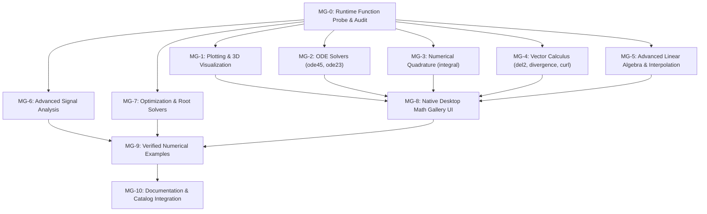

# Math Gallery Implementation Plan (PLAN-MG)

## 1. Executive Summary & Purpose

The **Math Gallery** transforms MatRust Studio into a comprehensive, practical scientific computing and mathematical learning environment. It provides interactive, browsable, and runnable scientific demonstrations spanning differential equations, vector calculus, linear algebra, control systems, signal processing, and numerical optimization.

This plan establishes the execution roadmap for tasks **MG-0 through MG-10**, directly grounded in the empirical findings of the **MG-0 Runtime Function Probe** ([docs/audit/math-probe.md](../audit/math-probe.md)).

### Empirical Baseline (from Task MG-0)
- **Total Function Inventory Probed:** 107
- **Currently Working (`EXISTS-WORKS`):** 52 (48.6%)
- **Missing / Unregistered (`MISSING`):** 55 (51.4%)
- **Crashes or Regressions (`CRASH`):** 0 (0.0%)

---

## 2. Work Breakdown Structure (MG-0 .. MG-10)

---

### Task MG-0: Runtime Function Probe, Evidence Logs, and Compatibility Audit
- **Objective:** Establish the empirical compatibility matrix across all 107 mathematical, ODE, signal processing, and visualization functions.
- **Current Verified Baseline:** Completed. 107 probes executed via native CLI `rustlab 0.1.0`. 52 `EXISTS-WORKS`, 55 `MISSING`, 0 `CRASH`.
- **Missing Capabilities:** None (task deliverable complete).
- **Dependencies:** None.
- **Implementation Boundaries:** `docs/verify-logs/**`, `docs/audit/math-probe.md`. Zero changes to numerical or UI source code.
- **Verification Requirements:** Cryptographic SHA-256 ledger in `docs/verify-logs/LOGS_SHA256.md`, metadata ledger in `docs/verify-logs/metadata.md`.
- **Estimated Size:** M (Completed).
- **Risks:** Divergence between static code presence and runtime registration (proven by `axis`, `colorbar`, `colormap`, `shading`, `view`).
- **Acceptance Criteria:** Every status backed by a standalone `.log` output with matching SHA-256 hash.

---

### Task MG-1: Plotting Capabilities and Coordination with Wave 1 P4
- **Objective:** Register missing plotting builtins, implement 3D line plots (`plot3`), vector fields (`quiver`), and contour maps (`contour`, `contourf`).
- **Current Verified Baseline:** 2D line (`plot`), `scatter`, `bar`, `hist`, `surf`, `subplot`, `xlim`, `ylim`, `title`, `xlabel`, `ylabel`, `zlabel`, `grid`, `legend`, `saveas` are verified working (17/43). Five functions (`axis`, `colorbar`, `colormap`, `shading`, `view`) are implemented in `plot_builtins.rs` but omitted from `register_all`.
- **Missing Capabilities:**
  - Registration of `axis`, `colorbar`, `colormap`, `shading`, `view`.
  - 3D line trajectories: `plot3(x, y, z)`.
  - Directional vector fields: `quiver(x, y, u, v)`.
  - Contour isolines: `contour(Z)` and filled contours `contourf(Z)`.
  - Logarithmic scaling plots: `semilogx`, `semilogy`, `loglog`.
- **Dependencies:** Wave 1 Task P4 (3D plotting baseline), `crates/rustlab-plot`.
- **Implementation Boundaries:** `crates/rustlab-plot/src/**`, `crates/rustlab-stdlib/src/plot_builtins.rs`, `crates/rustlab-stdlib/src/lib.rs`.
- **Verification Requirements:** SVG rendering tests asserting element counts, series bounds, and deterministic SVG output; desktop figure view tests.
- **Estimated Size:** L.
- **Expected Risks:** SVG generation complexity for filled contours and depth sorting in orthographic 3D projections.
- **Acceptance Criteria:** All 5 unregistered functions registered; `plot3`, `quiver`, and `contour` execute and generate non-empty, valid SVG figures verified by tests.

---

### Task MG-2: ODE Solvers (ode45, ode23), Solver Options, and Coordination with F4
- **Objective:** Provide adaptive Runge-Kutta numerical differential equation solvers callable from scripts via MATLAB-compatible signatures.
- **Current Verified Baseline:** No script-level ODE solvers registered in `rustlab-stdlib` (0/3). Block diagram simulations in `mlapp-sim` support Forward Euler, RK4, and Dormand-Prince, but lack script function handle bindings `@(t, y) ...`.
- **Missing Capabilities:**
  - `ode45`: Dormand-Prince 5(4) with adaptive step size, error norm tolerance, and FSAL (First Same As Last) optimization.
  - `ode23`: Bogacki-Shampine 3(2) adaptive solver for moderately stiff or smooth problems.
  - `odeset`: Structure generator for `RelTol`, `AbsTol`, `InitialStep`, `MaxStep`.
- **Dependencies:** `crates/rustlab-eval` function handle execution, coordination with Phase F4 (Advanced Solvers).
- **Implementation Boundaries:** `crates/rustlab-stdlib/src/solvers.rs`, `crates/rustlab-stdlib/src/lib.rs`.
- **Verification Requirements:** Analytic convergence tests (e.g. exponential decay $y' = -y$, harmonic oscillator, Van der Pol oscillator).
- **Estimated Size:** L.
- **Expected Risks:** Re-entrant evaluation of user-defined closures `@(t, y)` inside tight numerical solver loops without excessive allocation overhead.
- **Acceptance Criteria:** `ode45` and `ode23` integrate test ODEs within requested `RelTol` (1e-3) and produce monotonic time vectors.

---

### Task MG-3: Numerical Quadrature (integral, integral2, quad)
- **Objective:** Implement adaptive 1D numerical quadrature and multi-dimensional integration.
- **Current Verified Baseline:** Discrete trapezoidal integration `trapz` and `cumtrapz` are verified working. Continuous quadrature `integral`, `integral2`, `integral3`, `quad`, `quadgk` are completely missing (2/7).
- **Missing Capabilities:**
  - `integral(fun, a, b)`: Adaptive Simpson quadrature with recursive interval subdivision and tolerance control.
  - `quad`: Adaptive Simpson with classic MATLAB parameter signature.
  - `integral2`: Iterated double integration over 2D planar domains.
- **Dependencies:** `crates/rustlab-eval` function handle evaluation.
- **Implementation Boundaries:** `crates/rustlab-stdlib/src/solvers.rs` or `numerical.rs`.
- **Verification Requirements:** Integration of polynomials, Gaussians, and oscillatory functions against exact closed-form analytical solutions.
- **Estimated Size:** M.
- **Expected Risks:** Infinite recursion on singularities; requires recursion depth limit and singularity warnings.
- **Acceptance Criteria:** `integral(@(x) x.^2, 0, 1)` yields $0.33333333 \pm 10^{-8}$.

---

### Task MG-4: Vector Calculus, Discrete Laplacian, and Derivatives
- **Objective:** Complete vector field differential operators and numerical derivative matrices.
- **Current Verified Baseline:** 1D/2D `gradient` verified working. `del2`, `divergence`, `curl`, `jacobian`, `hessian` are missing (1/6).
- **Missing Capabilities:**
  - `del2(U)`: Five-point discrete Laplacian matrix operator.
  - `divergence(X, Y, U, V)`: Numerical divergence of 2D/3D vector fields.
  - `curl(X, Y, U, V)`: Numerical curl and vorticity of 2D/3D vector fields.
  - `jacobian(F, x0)`: Finite-difference Jacobian matrix evaluation of vector functions.
  - `hessian(f, x0)`: Second-order finite-difference Hessian matrix evaluation of scalar functions.
- **Dependencies:** `crates/rustlab-math`, `crates/rustlab-stdlib/src/numerical.rs`.
- **Implementation Boundaries:** `crates/rustlab-stdlib/src/numerical.rs`.
- **Verification Requirements:** Tests verifying known vector fields ($\vec{F} = [x, y] \implies \operatorname{div} = 2$, $\vec{F} = [-y, x] \implies \operatorname{curl} = 2$).
- **Estimated Size:** M.
- **Expected Risks:** Border boundary handling in non-uniform meshes.
- **Acceptance Criteria:** All vector calculus operators pass analytic validation on uniform grids within $10^{-6}$.

---

### Task MG-5: Advanced Linear Algebra, Interpolation, and Rectangular Systems
- **Objective:** Add missing linear algebra decompositions and piecewise interpolation.
- **Current Verified Baseline:** Linear algebra is the strongest subsystem (18/20 working: `inv`, `det`, `trace`, `norm`, `lu`, `qr`, `chol`, `eig`, `svd`, `pinv`, `rank`, `cond`, `null`, `orth`, `expm`, `kron`, `mldivide`, `mrdivide`). `schur` and `hess` are missing. `spline` and `pchip` are missing.
- **Missing Capabilities:**
  - Rectangular least-squares in `mldivide` ($A \setminus b$ for $M > N$ and $M < N$).
  - `schur`: Real Schur decomposition of general matrices.
  - `hess`: Hessenberg reduction.
  - `spline`: Cubic spline interpolation with not-a-knot end conditions.
  - `pchip`: Piecewise Cubic Hermite Interpolating Polynomial (shape-preserving).
- **Dependencies:** `faer` linear algebra core, `crates/rustlab-stdlib/src/linalg.rs`.
- **Implementation Boundaries:** `crates/rustlab-stdlib/src/linalg/**`, `crates/rustlab-stdlib/src/numerical.rs`.
- **Verification Requirements:** Matrix reconstruction residuals $< 10^{-12}$; knot preservation in interpolation.
- **Estimated Size:** M.
- **Expected Risks:** Pivot singularity handling in rank-deficient least-squares.
- **Acceptance Criteria:** Overdetermined systems solve via least squares with minimal residual; `spline` exactly matches analytic cubic knots.

---

### Task MG-6: Signal Analysis (Frequency Response, PSD, Deconvolution)
- **Objective:** Provide spectral analysis, filter frequency response, and deconvolution.
- **Current Verified Baseline:** 12/17 working (`fft`, `ifft`, `fft2`, `ifft2`, `fftshift`, `conv`, `filter`, `filtfilt`, `hamming`, `hann`, `blackman`, `xcorr`). Missing: `freqz`, `pwelch`, `spectrogram`, `deconv`, `residue`.
- **Missing Capabilities:**
  - `freqz(b, a, n)`: Complex frequency response of digital filters on unit circle.
  - `deconv(c, a)`: Polynomial deconvolution with quotient and remainder.
  - `pwelch(x, window, noverlap, nfft)`: Welch's averaged modified periodogram.
- **Dependencies:** `rustfft`, `crates/rustlab-stdlib/src/signal_proc.rs`.
- **Implementation Boundaries:** `crates/rustlab-stdlib/src/signal_proc.rs`.
- **Verification Requirements:** Unit circle frequency response of low-pass FIR filter; recovery of original polynomial in deconvolution.
- **Estimated Size:** M.
- **Expected Risks:** Window normalisation factors and FFT scaling conventions.
- **Acceptance Criteria:** `freqz` matches analytic transfer function magnitude response across DC, Nyquist, and cut-off frequencies.

---

### Task MG-7: Optimization and Nonlinear Equation Solvers
- **Objective:** Implement unconstrained and bounded optimization solvers.
- **Current Verified Baseline:** 0/9 working. No optimization or root-finding functions currently registered.
- **Missing Capabilities:**
  - `fzero(fun, x0)`: Brent's root-finding method (combination of bisection, secant, and inverse quadratic interpolation).
  - `fminsearch(fun, x0)`: Nelder-Mead simplex unconstrained multivariable optimization.
  - `fminbnd(fun, x1, x2)`: Golden-section search with parabolic interpolation over bounded interval.
  - `fsolve(fun, x0)`: Newton-Raphson / Powell hybrid method for systems of nonlinear equations.
- **Dependencies:** `crates/rustlab-eval` function handles, coordination with Phase F9 (Optimization).
- **Implementation Boundaries:** `crates/rustlab-stdlib/src/solvers.rs`.
- **Verification Requirements:** Rosenbrock banana function minimization, quadratic test functions, transcendent equation root finding.
- **Estimated Size:** L.
- **Expected Risks:** Stalling in flat valleys or non-convergence on stiff non-linearities.
- **Acceptance Criteria:** `fzero` solves $\cos(x) - x = 0$ to $10^{-10}$; `fminsearch` converges on 2D Rosenbrock minimum at $(1, 1)$.

---

### Task MG-8: Native Desktop Math Gallery UI Integration
- **Objective:** Design and implement the native Math Gallery panel inside MatRust Studio desktop IDE.
- **Current Verified Baseline:** Desktop application features Editor, Workspace, Command Window, Figure viewer, Current Folder, and Simulink block diagram editor (`egui_dock` layout). No Gallery browser panel exists.
- **Missing Capabilities:**
  - Native Gallery browser panel (dockable via `DockTab::MathGallery`).
  - Categorized card grid with thumbnails, difficulty badges, and mathematical descriptions.
  - "Open in Editor" and "Run Example" one-click action buttons.
  - Auto-figure capture routing: figures produced by gallery runs open in dedicated figure dock tabs, preserving subplot layouts.
- **Dependencies:** `apps/desktop`, `egui`, `crates/rustlab-plot`.
- **Implementation Boundaries:** `apps/desktop/src/math_gallery.rs`, `apps/desktop/src/dock.rs`, `apps/desktop/src/app.rs`.
- **Verification Requirements:** Dock preset serialization tests, layout non-overlap tests at 900x600, 1280x800, 1920x1080. Marked `UNVERIFIED` in `docs/FEATURE-REGISTRY.md` until human visual inspection.
- **Estimated Size:** L.
- **Expected Risks:** Cluttered UI on small display resolutions; figure window docking conflicts.
- **Acceptance Criteria:** Gallery opens cleanly, loads all catalog items, runs scripts through `rustlab-eval`, and renders outputs without UI panic.

---

### Task MG-9: Verified Numerical Example Programs
- **Objective:** Author and verify a rich suite of realistic, clean-room MATLAB `.m` example programs covering core engineering disciplines.
- **Current Verified Baseline:** Standalone verification tests exist, but no centralized `.m` educational example catalog.
- **Catalog Scope (20 Reference Examples):**
  1. *Lorenz Chaotic Attractor* (ODE45, 3D line trajectory `plot3`).
  2. *Predator-Prey Population Dynamics* (Lotka-Volterra ODE23, phase plane).
  3. *Van der Pol Stiff Oscillator* (Relaxation oscillations, limit cycles).
  4. *Double Pendulum Simulation* (Coupled nonlinear ODEs, chaotic motion).
  5. *2D Heat Diffusion on a Plate* (PDE finite difference, `del2`, surface plot `surf`).
  6. *Wave Equation Simulation* (1D hyperbolic PDE, vibrating string).
  7. *Electromagnetic Vector Potential* (Gradient, divergence, curl, vector quiver).
  8. *RLC Circuit Transient Response* (State-space / ODE, damping regimes).
  9. *Three-Phase AC Power Transmission* (Phasors, harmonics, complex power).
  10. *Mass-Spring-Damper Step Response* (Second-order system, overshoot, settling time).
  11. *PID Controller Tuning* (Closed-loop feedback, step response comparison).
  12. *Audio Equalizer & FIR Filter Design* (Hamming window, frequency response `freqz`).
  13. *FFT Spectrum Analysis of Noisy Chirp* (Signal detection, Welch PSD `pwelch`).
  14. *ECG Biomedical Signal Denoising* (Zero-phase filtering `filtfilt`).
  15. *Radar Pulse Compression* (Cross-correlation `xcorr`, matched filter).
  16. *Orbital Trajectory & Hohmann Transfer* (Keplerian orbital mechanics, `plot3`).
  17. *Unconstrained Parameter Estimation* (Nelder-Mead `fminsearch`, nonlinear curve fitting).
  18. *Roots of Transcendental Equations* (Brent's method `fzero`).
  19. *Structural Frame Truss Analysis* (Stiffness matrix, overdetermined linear system `A \ b`).
  20. *Image Edge Detection & Filtering* (2D convolution, Laplacian filtering).
- **Dependencies:** Tasks MG-1 through MG-7.
- **Implementation Boundaries:** `examples/math_gallery/*.m`, `apps/desktop/src/gallery_catalog.rs`.
- **Verification Requirements:** Automated test suite executing every single gallery `.m` file to completion with numerical tolerance assertions.
- **Estimated Size:** L.
- **Expected Risks:** Long test runtimes; tests must complete within CI timeout limits (< 30s for the whole suite).
- **Acceptance Criteria:** Every example executes deterministically, passes numerical assertions, and produces at least one figure.

---

### Task MG-10: Generated Documentation, Examples Catalog, and README Integration
- **Objective:** Produce comprehensive user documentation, markdown function references, and catalog index pages.
- **Current Verified Baseline:** Builtins documented in `docs/functions/`; master workplans in `docs/`.
- **Missing Capabilities:**
  - Gallery guide: `docs/gallery/README.md`.
  - Individual example theory pages: `docs/gallery/examples/*.md`.
  - Updated `README.md` and `docs/FEATURE-REGISTRY.md`.
- **Dependencies:** Task MG-9.
- **Implementation Boundaries:** `docs/gallery/**`, `docs/functions/**`, `README.md`.
- **Verification Requirements:** `python scripts/check_docs.py` (0 personal path leaks, 100% link resolution, builtins coverage).
- **Estimated Size:** M.
- **Expected Risks:** Link rot and stale test count documentation.
- **Acceptance Criteria:** Documentation passes `check_docs.py` with zero errors and zero privacy leaks.

---

## 3. Task Sizing & Dependency Matrix

| Task ID | Task Description | Size | Dependencies | Release Train Placement |
| :--- | :--- | :---: | :--- | :--- |
| **MG-0** | Runtime Function Probe & Audit | **M** | *Completed* | Baseline |
| **MG-1** | Plotting & 3D Visualization (`plot3`, `quiver`) | **L** | Wave 1 Task P4 | Release Train R1 / R2 |
| **MG-2** | ODE Solvers (`ode45`, `ode23`, `odeset`) | **L** | Phase F4 | Release Train R2 |
| **MG-3** | Numerical Quadrature (`integral`, `quad`) | **M** | MG-0 | Release Train R2 |
| **MG-4** | Vector Calculus (`del2`, `divergence`, `curl`) | **M** | MG-0 | Release Train R2 |
| **MG-5** | Advanced Linear Algebra & Interpolation | **M** | MG-0 | Release Train R2 |
| **MG-6** | Signal Analysis (`freqz`, `pwelch`, `deconv`) | **M** | MG-0 | Release Train R3 |
| **MG-7** | Optimization & Root Solvers (`fzero`, `fminsearch`) | **L** | Phase F9 | Release Train R4 |
| **MG-8** | Native Desktop Math Gallery UI Integration | **L** | Wave 0 (L1..L4) | Release Train R3 |
| **MG-9** | Verified Numerical Example Programs (20 items) | **L** | MG-1..MG-7 | Release Train R3 |
| **MG-10** | Generated Documentation & Catalog Integration | **M** | MG-8, MG-9 | Release Train R3 |

---

## 4. Release Train & Architecture Governance

1. **Native Integration Only:** The Math Gallery resides directly inside `apps/desktop` as an `egui` panel. No external web server, Electron wrapper, or Python backend is permitted.
2. **Deterministic Evaluation:** All examples execute through `rustlab-eval` and render to `rustlab-plot`. Figures open in dedicated figure dock tabs, preserving multi-subplot layouts.
3. **Clean-Room Enforcement:** All algorithms (Dormand-Prince, Bogacki-Shampine, Nelder-Mead, Brent) are authored clean-room from public textbooks and standard numerical literature (P14/P15 compliance).
4. **Test Monotonicity:** Test counts must strictly increase monotonically in `docs/test-manifest.txt`.
5. **No Sandbox Bypasses in Production:** All runtime probes and automated test suites operate within standard sandboxed environments.
