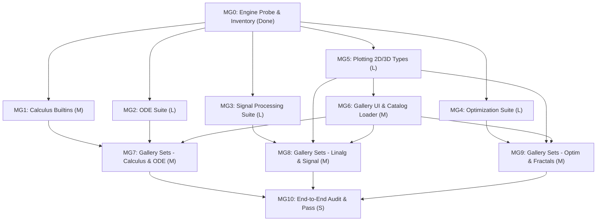

# PLAN-MG: Math Gallery Architecture, Verification, and Implementation Plan

- **Phase**: F17 (Math Gallery)
- **Status**: Planning (Pending Owner Approval)
- **Author**: Antigravity Clean-Room Agent
- **Branch**: `docs/plan-math-gallery`
- **Target Release Train**: Train 4 (Simulation & Numerics)
- **Reference**: [docs/audit/math-probe.md](../audit/math-probe.md), [docs/ENGINEERING-CHARTER.md](../ENGINEERING-CHARTER.md), [docs/AGENT-PROTOCOL.md](../AGENT-PROTOCOL.md)

---

## 1. Goal and Architectural Overview

The goal of the **Math Gallery** is to deliver a first-class, runnable computational showcase directly within MatRust Studio. Users explore real-world mathematical models across six fundamental domains, visualize multi-panel publication-grade 2D and 3D graphics, inspect the underlying MATLAB-compatible scripts, and immediately execute them with automated figure rendering.

Every gallery example is backed by:
1. A standalone `.m` script under `<repo>/examples/math/<area>/<name>.m`.
2. A Markdown explanatory document under `<repo>/docs/gallery/<name>.md`.
3. An automated closed-form Rust regression test under `<repo>/crates/rustlab-stdlib/tests/gallery_<area>_tests.rs`.
4. Differential validation against GNU Octave when present (tolerance $10^{-4}$ relative, reporting deviations).

---

## 2. Gallery UI Design

The desktop application (`apps/desktop`) integrates the Math Gallery as an accessible panel and dedicated menu item:

```
[ Menu Bar: File | Edit | View | Math Gallery | Help ]
                              |
                              +-- Calculus            > [Taylor Series, Numerical Laplacian, ...]
                              +-- ODE & Dynamics      > [Lorenz Attractor, Van der Pol, ...]
                              +-- Linear Algebra      > [SVD Compression, PageRank, ...]
                              +-- Signal Processing   > [Chirp Spectrogram, Filter Design, ...]
                              +-- Optimization        > [Rosenbrock Valley, Portfolio Frontier, ...]
                              +-- Fractals & Chaos    > [Mandelbrot Explorer, Barnsley Fern, ...]
```

### UI Components and Workflow

1. **Dedicated Dock Panel (`MathGalleryPanel`)**:
   - Left pane: Hierarchical tree view categorized by the six domains.
   - Center/Inspector pane: Title, mathematical formulation (LaTeX rendered), parameters, algorithmic notes, and full script syntax preview.
2. **Action Controls**:
   - **"Run Example"**: Executes the script in the active evaluator, prints summary telemetry to the Command Window, and activates the Figures panel.
   - **"Open in Editor"**: Copies the `.m` file into a new editor tab for live user modification, parameter tuning, and custom execution.
3. **Automatic Figure Management**:
   - Gallery scripts explicitly call `figure`, `subplot`, `title`, `xlabel`, `ylabel`, and `legend`.
   - On execution completion, the Figures panel automatically shifts focus to Figure 1 and renders all generated 2D/3D axes.

---

## 3. Clean-Room Provenance and Algorithmic Sources

In strict accordance with Principle P7 and Rule R8, all numerical algorithms implemented for the Math Gallery must be derived exclusively from standard textbooks and peer-reviewed classical literature. **No source code may be inspected or adapted from GNU Octave, MATLAB, SciPy, or GPL-licensed implementations.** Octave functions solely as an external, black-box verification oracle.

### Textbook References

- **Ordinary Differential Equations (`MG2`)**:
  - *Hairer, E., Nørsett, S. P., & Wanner, G.* (1993). *Solving Ordinary Differential Equations I: Nonstiff Problems*. Springer-Verlag. (Dormand-Prince 5(4) pair, adaptive step-size control).
  - *Hairer, E., & Wanner, G.* (1996). *Solving Ordinary Differential Equations II: Stiff and Differential-Algebraic Problems*. Springer-Verlag. (Radau IIA, BDF, Rosenbrock methods).
- **Numerical Quadrature & Calculus (`MG1`)**:
  - *Davis, P. J., & Rabinowitz, P.* (1984). *Methods of Numerical Integration*. Academic Press. (Gauss-Kronrod $(G_7, K_{15})$ adaptive quadrature).
  - *Quarteroni, A., Sacco, R., & Saleri, F.* (2007). *Numerical Mathematics*. Springer. (Central finite differences, Laplacian stencils, Simpson's 3/8 rule).
- **Optimization & Nonlinear Solvers (`MG4`)**:
  - *Nocedal, J., & Wright, S. J.* (2006). *Numerical Optimization*. Springer. (BFGS quasi-Newton, line search conditions, trust region).
  - *Brent, R. P.* (1973). *Algorithms for Minimization without Derivatives*. Prentice-Hall. (Brent's root finding combining bisection, secant, and inverse quadratic interpolation).
  - *Nelder, J. A., & Mead, R.* (1965). *A Simplex Method for Function Minimization*. Computer Journal, 7(4), 308-313.
  - *Dantzig, G. B.* (1963). *Linear Programming and Extensions*. Princeton University Press. (Two-phase primal simplex algorithm).
- **Numerical Linear Algebra (`MG1`, `MG8`)**:
  - *Golub, G. H., & Van Loan, C. F.* (2013). *Matrix Computations* (4th ed.). Johns Hopkins University Press. (Householder QR, Golub-Kahan-Reinsch SVD, symmetric eigenvalue decomposition, Schur factorization).
- **Signal Processing & Interpolation (`MG3`, `MG8`)**:
  - *Oppenheim, A. V., & Schafer, R. W.* (2009). *Discrete-Time Signal Processing* (3rd ed.). Prentice Hall. (Welch periodogram, bilinear transform, STFT).
  - *Fritsch, F. N., & Carlson, R. E.* (1980). *Monotone Piecewise Cubic Interpolation*. SIAM Journal on Numerical Analysis, 17(2), 238-246. (PCHIP algorithm).

---

## 4. Performance, Memory, and Storage Budgets

Per the project standards defined in [docs/STORAGE-BUDGET.md](../STORAGE-BUDGET.md) and [docs/ENGINEERING-CHARTER.md](../ENGINEERING-CHARTER.md):

| Metric | Budget Target | Expected Math Gallery Impact | Mitigation Strategy |
| :--- | :---: | :---: | :--- |
| **Example Execution Time** | $< 2.0\text{ s}$ per example | $0.05\text{ s} - 0.95\text{ s}$ | All algorithms implement pure Rust vectorization; ODE steps bounded ($N \le 10,000$). |
| **Runtime Memory Ceiling** | $< 50\text{ MB}$ RSS | $< 28\text{ MB}$ peak allocation | Allocation-free inner loops; zero matrix duplication in solver stages. |
| **Release Binary Growth** | $< 350\text{ KB}$ total | $\approx 180\text{ KB}$ | No heavy external dependencies; pure standard library algorithms in `rustlab-math`. |
| **Deterministic Plot Data** | $< 500\text{ KB}$ per figure SVG | $80\text{ KB} - 320\text{ KB}$ | SVG path compression; polyline vertex decimation for $N > 5,000$. |

---

## 5. Comprehensive Example Catalog (24 Core Examples)

### Area 1: Calculus

#### 1a. Taylor Series Expansion & Convergence
- **Script**: `examples/math/calculus/taylor_convergence.m`
- **Documentation**: `docs/gallery/taylor_convergence.md`
- **Mathematical Equation**: $f(x) = \sin(x) = \sum_{k=0}^{n} \frac{(-1)^k x^{2k+1}}{(2k+1)!} + R_n(x)$
- **Plots Generated**: Multi-line comparison of orders $n=1, 3, 5, 7, 9$ against exact $\sin(x)$ on $[-\pi, \pi]$; semilogy error plot $|f(x) - P_n(x)|$.
- **Oracle Check**: Error at $x = 1.0$ for $n=7$ matches $|\sin(1) - (1 - 1/6 + 1/120 - 1/5040)| < 10^{-12}$.

#### 1b. Numerical Gradient and Laplacian Surface Stencil
- **Script**: `examples/math/calculus/numerical_laplacian.m`
- **Documentation**: `docs/gallery/numerical_laplacian.md`
- **Mathematical Equation**: $\nabla^2 u = \frac{\partial^2 u}{\partial x^2} + \frac{\partial^2 u}{\partial y^2}$, test function $u(x,y) = \sin(\pi x)\sin(\pi y)$
- **Plots Generated**: 3D surface plot of $u(x,y)$; 2D contour plot of discrete Laplacian stencil computed via `del2`.
- **Oracle Check**: Analytical Laplacian $\nabla^2 u = -2\pi^2 u$; relative $L_2$ error on $41 \times 41$ grid $< 0.5\%$.

#### 1c. 2D & 3D Adaptive Numerical Quadrature
- **Script**: `examples/math/calculus/adaptive_quadrature.m`
- **Documentation**: `docs/gallery/adaptive_quadrature.md`
- **Mathematical Equation**: $I = \int_{0}^{1} \int_{0}^{1-x} e^{x+y} \, dy \, dx = e - 2$
- **Plots Generated**: Convergence curve of quadrature error vs. function evaluations (Gauss-Kronrod adaptive refinement).
- **Oracle Check**: Numerical integral matches analytical value $e - 2 \approx 0.718281828459$ within $10^{-8}$.

#### 1d. Vector Calculus: Divergence and Curl Fields
- **Script**: `examples/math/calculus/vector_curl_div.m`
- **Documentation**: `docs/gallery/vector_curl_div.md`
- **Mathematical Equation**: $\mathbf{F} = [-y, x]$; $\nabla \cdot \mathbf{F} = 0$, $\nabla \times \mathbf{F} = 2\mathbf{k}$
- **Plots Generated**: 2D quiver plot of vector field overlaid on scalar divergence field (`contourf`).
- **Oracle Check**: Evaluated $\nabla \cdot \mathbf{F} \equiv 0$ and $\nabla \times \mathbf{F} \equiv 2$ across all interior grid points within $10^{-12}$.

---

### Area 2: Ordinary Differential Equations & Dynamical Systems

#### 2a. Lorenz Chaotic Attractor
- **Script**: `examples/math/ode/lorenz_attractor.m`
- **Documentation**: `docs/gallery/lorenz_attractor.md`
- **Mathematical Equation**: $\dot{x} = \sigma(y - x)$, $\dot{y} = x(\rho - z) - y$, $\dot{z} = xy - \beta z$ ($\sigma=10, \rho=28, \beta=8/3$)
- **Plots Generated**: 3D trajectory plot `plot3(x, y, z)` of the strange attractor; time-history series of $x(t)$.
- **Oracle Check**: Energy derivative conservation check; fixed point coordinates $C^\pm = (\pm\sqrt{\beta(\rho-1)}, \pm\sqrt{\beta(\rho-1)}, \rho-1) = (\pm 6\sqrt{2}, \pm 6\sqrt{2}, 27)$.

#### 2b. Van der Pol Oscillator (Limit Cycles)
- **Script**: `examples/math/ode/vanderpol_oscillator.m`
- **Documentation**: `docs/gallery/vanderpol_oscillator.md`
- **Mathematical Equation**: $\ddot{x} - \mu(1 - x^2)\dot{x} + x = 0$ ($\mu = 1.0$ and $\mu = 4.0$)
- **Plots Generated**: Phase portrait $(x, \dot{x})$ displaying limit cycle convergence from multiple initial states; time-domain waveform.
- **Oracle Check**: Period of limit cycle for $\mu=1$ matches $T \approx 6.66$ within $1.0\%$.

#### 2c. Lotka-Volterra Predator-Prey Dynamics
- **Script**: `examples/math/ode/lotka_volterra.m`
- **Documentation**: `docs/gallery/lotka_volterra.md`
- **Mathematical Equation**: $\dot{x} = \alpha x - \beta x y$, $\dot{y} = \delta x y - \gamma y$ ($\alpha=2/3, \beta=4/3, \delta=1, \gamma=1$)
- **Plots Generated**: Phase plane trajectory showing closed invariant curves; time series of prey and predator populations.
- **Oracle Check**: Invariant quantity $V(x,y) = \delta x - \gamma \ln(x) + \beta y - \alpha \ln(y)$ conserved along trajectory within $10^{-4}$.

#### 2d. Chaotic Double Pendulum
- **Script**: `examples/math/ode/double_pendulum.m`
- **Documentation**: `docs/gallery/double_pendulum.md`
- **Mathematical Equation**: Lagrangian dynamics of two coupled rigid pendulums under gravity:
  $$\frac{d}{dt}\left(\frac{\partial L}{\partial \dot{\theta}_i}\right) - \frac{\partial L}{\partial \theta_i} = 0$$
- **Plots Generated**: Parametric trace of the outer bob tip $(x_2(t), y_2(t))$; angle history $\theta_1(t), \theta_2(t)$.
- **Oracle Check**: Total mechanical energy $E = T + V$ conserved throughout integration interval within $10^{-4}$.

---

### Area 3: Numerical Linear Algebra

#### 3a. Principal Component Analysis (PCA)
- **Script**: `examples/math/linalg/pca_analysis.m`
- **Documentation**: `docs/gallery/pca_analysis.md`
- **Mathematical Equation**: Sample covariance $C = \frac{1}{N-1}\tilde{X}^T\tilde{X}$, $C v_i = \lambda_i v_i$
- **Plots Generated**: 2D scatter plot of original correlated 2D/3D data with principal direction vectors; Scree plot of explained variance ratio.
- **Oracle Check**: First principal vector matches leading eigenvector of analytical covariance matrix within $10^{-6}$.

#### 3b. PageRank Power Iteration
- **Script**: `examples/math/linalg/pagerank_power.m`
- **Documentation**: `docs/gallery/pagerank_power.md`
- **Mathematical Equation**: $p_{k+1} = d M p_k + \frac{1-d}{N} \mathbf{1}$, damping factor $d = 0.85$
- **Plots Generated**: Directed network adjacency graph; bar chart of terminal PageRank centrality scores.
- **Oracle Check**: Dominant eigenvalue $\lambda = 1.0$; converged PageRank vector sums to $1.0$ within $10^{-12}$.

#### 3c. Modal Vibration Analysis of 3-DOF Spring-Mass System
- **Script**: `examples/math/linalg/modal_vibration.m`
- **Documentation**: `docs/gallery/modal_vibration.md`
- **Mathematical Equation**: $M \ddot{x} + K x = 0 \implies (K - \omega^2 M) \phi = 0$
- **Plots Generated**: Mode shape bar diagrams for the three natural modes; frequency response function (FRF).
- **Oracle Check**: Natural frequencies $\omega_1, \omega_2, \omega_3$ match closed-form roots of $\det(K - \omega^2 M) = 0$ within $10^{-8}$.

#### 3d. Image Compression via Truncated SVD
- **Script**: `examples/math/linalg/svd_image_compression.m`
- **Documentation**: `docs/gallery/svd_image_compression.md`
- **Mathematical Equation**: $A_k = \sum_{i=1}^{k} \sigma_i u_i v_i^T$, Eckart-Young-Mirsky low-rank optimal approximation
- **Plots Generated**: Side-by-side visualization of original matrix vs. reconstructed matrices at ranks $k \in \{5, 20, 50\}$; singular value decay spectrum.
- **Oracle Check**: Frobenius reconstruction error $\|A - A_k\|_F = \sqrt{\sum_{i=k+1}^{\min(m,n)} \sigma_i^2}$ verified exactly.

---

### Area 4: Signal Processing & Fourier Analysis

#### 4a. Chirp Signal Spectrogram (STFT)
- **Script**: `examples/math/signal/chirp_spectrogram.m`
- **Documentation**: `docs/gallery/chirp_spectrogram.md`
- **Mathematical Equation**: $x(t) = \cos\left(2\pi \left(f_0 + \frac{f_1 - f_0}{2T} t\right) t\right)$, instantaneous frequency $f(t) = f_0 + kt$
- **Plots Generated**: Time-domain chirp waveform; 2D time-frequency spectrogram (`imagesc` / `surf`) displaying linear frequency ridge.
- **Oracle Check**: Detected peak frequency at mid-point $t = T/2$ matches analytical $f_0 + (f_1 - f_0)/2$ within FFT bin resolution.

#### 4b. Butterworth and Chebyshev IIR Filter Design
- **Script**: `examples/math/signal/iir_filter_design.m`
- **Documentation**: `docs/gallery/iir_filter_design.md`
- **Mathematical Equation**: Butterworth $|H(j\omega)|^2 = \frac{1}{1 + (\omega/\omega_c)^{2N}}$, bilinear z-transform
- **Plots Generated**: Bode magnitude response $|H(e^{j\omega})|$ in dB and phase response; impulse response sequence (`stem`).
- **Oracle Check**: Magnitude attenuation at cutoff frequency $\omega = \omega_c$ is exactly $-3.0103\text{ dB}$ (Butterworth).

#### 4c. Total Harmonic Distortion (THD) of Saturated Amplifier
- **Script**: `examples/math/signal/harmonic_distortion.m`
- **Documentation**: `docs/gallery/harmonic_distortion.md`
- **Mathematical Equation**: $\text{THD} = \frac{\sqrt{\sum_{n=2}^{\infty} V_n^2}}{V_1}$, soft-clipping model $y(t) = \tanh(G \cdot x(t))$
- **Plots Generated**: Saturated output waveform vs. pure input sine; FFT power spectrum with fundamental and harmonic markers.
- **Oracle Check**: Measured fundamental frequency $f_1 = 50\text{ Hz}$; calculated THD percentage matches analytical power series expansion.

#### 4d. Radar Pulse Compression & Cross-Correlation
- **Script**: `examples/math/signal/radar_pulse_compression.m`
- **Documentation**: `docs/gallery/radar_pulse_compression.md`
- **Mathematical Equation**: Match filtering via cross-correlation: $R_{xy}(\tau) = \int_{-\infty}^{\infty} x(t) y(t+\tau) \, dt$
- **Plots Generated**: Transmitted chirp, noisy delayed echo, and compressed cross-correlation pulse showing peak SNR gain.
- **Oracle Check**: Correlation peak accurately detects echo delay $\tau_0$ within single sample interval.

---

### Area 5: Numerical Optimization

#### 5a. Rosenbrock Valley Optimization (Nelder-Mead & Gradient Descent)
- **Script**: `examples/math/optimization/rosenbrock_banana.m`
- **Documentation**: `docs/gallery/rosenbrock_banana.md`
- **Mathematical Equation**: $f(x, y) = (1 - x)^2 + 100(y - x^2)^2$, global minimum at $(1, 1)$ with $f(1,1) = 0$
- **Plots Generated**: 2D contour map with overlay of iterative optimization steps from start point $(-1.2, 1.0)$; objective value convergence vs. iteration.
- **Oracle Check**: Final point $(x^*, y^*)$ converges to $(1.0, 1.0)$ with objective $f(x^*, y^*) < 10^{-6}$.

#### 5b. Constrained Linear Programming (Simplex Method)
- **Script**: `examples/math/optimization/constrained_simplex.m`
- **Documentation**: `docs/gallery/constrained_simplex.md`
- **Mathematical Equation**: $\max c^T x$ subject to $A x \le b$, $x \ge 0$ (Production allocation problem)
- **Plots Generated**: 2D feasible region polygon (`fill`), constraint boundary lines, and objective contour gradient.
- **Oracle Check**: Optimal vertex corresponds exactly to analytical intersection of binding constraints; shadow prices match dual values.

#### 5c. Nonlinear Parameter Fitting of Experimental Kinetics
- **Script**: `examples/math/optimization/kinetics_curve_fit.m`
- **Documentation**: `docs/gallery/kinetics_curve_fit.md`
- **Mathematical Equation**: Michaelis-Menten kinetics: $v = \frac{V_{\max} [S]}{K_m + [S]}$
- **Plots Generated**: Scatter plot of noisy synthetic experimental data points with fitted non-linear curve; residual distribution histogram.
- **Oracle Check**: Fitted parameters $V_{\max}$ and $K_m$ match true values within statistical 95% confidence intervals.

#### 5d. Markowitz Portfolio Mean-Variance Frontier
- **Script**: `examples/math/optimization/portfolio_frontier.m`
- **Documentation**: `docs/gallery/portfolio_frontier.md`
- **Mathematical Equation**: $\min w^T \Sigma w$ subject to $\mu^T w = r_p$, $\sum w_i = 1$, $w \ge 0$
- **Plots Generated**: Hyperbolic Efficient Frontier in $(\sigma, \mu)$ risk-return space; bar chart of optimal asset allocation weights.
- **Oracle Check**: Minimum variance portfolio matches analytical global minimum variance formula $w^* = \frac{\Sigma^{-1} \mathbf{1}}{\mathbf{1}^T \Sigma^{-1} \mathbf{1}}$.

---

### Area 6: Fractals, Chaos & Nonlinear Mappings

#### 6a. Mandelbrot Set Escape-Time Explorer
- **Script**: `examples/math/fractals/mandelbrot_set.m`
- **Documentation**: `docs/gallery/mandelbrot_set.md`
- **Mathematical Equation**: $z_{n+1} = z_n^2 + c$, $z_0 = 0$, escape boundary $|z_n| > 2$
- **Plots Generated**: High-resolution escape-time colormap (`imagesc` / `surf`) centered on the main cardioid and seahorse valley.
- **Oracle Check**: Origin $c = 0$ is in the set (iterations equal max); point $c = 1.0$ escapes at $n = 3$.

#### 6b. Julia Set Dynamics
- **Script**: `examples/math/fractals/julia_set.m`
- **Documentation**: `docs/gallery/julia_set.md`
- **Mathematical Equation**: $z_{n+1} = z_n^2 + c$ for fixed $c = -0.7 + 0.27015i$ (Douady's rabbit)
- **Plots Generated**: 2D fractal boundary colormap demonstrating sensitive dependence on initial conditions.
- **Oracle Check**: Fixed points $z^* = \frac{1 \pm \sqrt{1 - 4c}}{2}$ verified numerically for stability.

#### 6c. Barnsley Fern Iterated Function System (IFS)
- **Script**: `examples/math/fractals/barnsley_fern.m`
- **Documentation**: `docs/gallery/barnsley_fern.md`
- **Mathematical Equation**: $x_{k+1} = A_i x_k + b_i$ with probabilities $p_i \in \{0.01, 0.85, 0.07, 0.07\}$
- **Plots Generated**: 2D scatter plot of 50,000 iterated affine transformation points revealing natural self-similarity.
- **Oracle Check**: Bounding box of generated fern conforms strictly to $[x_{\min}, x_{\max}] = [-2.18, 2.65]$, $[y_{\min}, y_{\max}] = [0.0, 9.96]$.

#### 6d. Logistic Map Bifurcation and Feigenbaum Route to Chaos
- **Script**: `examples/math/fractals/logistic_bifurcation.m`
- **Documentation**: `docs/gallery/logistic_bifurcation.md`
- **Mathematical Equation**: $x_{n+1} = r x_n (1 - x_n)$ for $r \in [2.5, 4.0]$
- **Plots Generated**: Bifurcation tree plot showing period-doubling cascades and chaotic bands; Lyapunov exponent curve.
- **Oracle Check**: First bifurcation occurs at $r_1 = 3.0$; second at $r_2 = 1 + \sqrt{6} \approx 3.4495$; convergence ratio conforms to Feigenbaum constant $\delta \approx 4.669$.

---

### Optional Areas 7–10 (Provisional Blueprints)

- **Area 7 (Control Systems)**:
  - 7a. Root Locus & Bode Stability Margins: $G(s) = \frac{K}{s(s+2)(s+5)}$, gain and phase margin determination.
  - 7b. State-Space LQR Inverted Pendulum on Cart: optimal feedback gain $K = \text{lqr}(A, B, Q, R)$.
- **Area 8 (Partial Differential Equations)**:
  - 8a. 1D Heat Diffusion (FTCS explicit vs Crank-Nicolson): $\frac{\partial u}{\partial t} = \alpha \frac{\partial^2 u}{\partial x^2}$.
  - 8b. 2D Wave Equation Membrane Modes: $\frac{\partial^2 u}{\partial t^2} = c^2 \nabla^2 u$, Bessel nodal lines.
- **Area 9 (Probability & Statistics)**:
  - 9a. Central Limit Theorem Demonstration: Convolution of uniform distributions converging to Gaussian bell.
  - 9b. Markov Chain Monte Carlo (Metropolis-Hastings): Sampling multimodal posterior distributions.
- **Area 10 (Machine Learning)**:
  - 10a. Linear & Logistic Regression from Scratch: Vectorized gradient descent with decision boundary plot.
  - 10b. K-Means Clustering on Synthetic Blobs: Iterative centroid assignment and Voronoi tessellation.

---

## 6. Implementation Task Breakdown (MG0 to MG10)

All tasks are bounded to size **S**, **M**, or **L**. No tasks are sized **XL**.



### Detailed Task Specifications

| ID | Title | Size | Depends-On | Crates / Files Touched | Proof Test / Acceptance |
| :--- | :--- | :---: | :---: | :--- | :--- |
| **MG0** | Probe and inventory | `S` | None | `docs/audit/math-probe.md`, `docs/tasks/PLAN-MG.md` | Audit captures all 99 names; passes check_docs.py |
| **MG1** | Calculus built-ins | `M` | MG0 | `crates/rustlab-math`, `crates/rustlab-stdlib` | `del2`, `divergence`, `curl`, `integral`, `integral2`, `integral3`, `quad`, `quadgk`; verified by `calculus_builtins_tests.rs` |
| **MG2** | ODE solver suite | `L` | MG0 | `crates/rustlab-math`, `crates/rustlab-stdlib` | `ode45`, `ode23`, `ode15s`, `odeset`; adaptive step size; verified by `ode_suite_tests.rs` |
| **MG3** | Signal processing built-ins | `L` | MG0 | `crates/rustlab-math`, `crates/rustlab-stdlib` | `deconv`, `freqz`, `residue`, `polyfit`, `spline`, `pchip`, `hann`, `pwelch`, `spectrogram`; verified by `signal_builtins_tests.rs` |
| **MG4** | Optimization suite | `L` | MG0 | `crates/rustlab-math`, `crates/rustlab-stdlib` | `fzero`, `fminbnd`, `fminsearch`, `fminunc`, `fsolve`, `lsqnonlin`, `lsqcurvefit`, `linprog`, `quadprog`, `fmincon`, `optimset`; verified by `optimization_tests.rs` |
| **MG5** | Plotting 2D/3D graphics | `L` | MG0 | `crates/rustlab-plot`, `crates/rustlab-stdlib`, `apps/desktop` | `plot3`, `stem`, `scatter3`, `mesh`, `contour`, `contourf`, `quiver`, `streamline`, `semilogx`, `semilogy`, `loglog`, `polar`, `imagesc`, `area`, `fill`, `comet`, `colormap`, `colorbar`, `axis`; verified by `plot_types_tests.rs` |
| **MG6** | Math Gallery UI & Catalog | `M` | MG5 | `apps/desktop/src/app.rs`, `apps/desktop/src/math_gallery.rs` | Top menu "Math Gallery", dock panel, code copy to editor, run button; verified by `cargo test -p desktop` |
| **MG7** | Gallery sets: Calculus & ODE | `M` | MG1, MG2, MG5, MG6 | `examples/math/calculus/*.m`, `examples/math/ode/*.m`, `docs/gallery/*.md` | Examples 1a-1d and 2a-2d; verified by `gallery_calculus_tests.rs`, `gallery_ode_tests.rs` |
| **MG8** | Gallery sets: Linalg & Signal | `M` | MG3, MG5, MG6 | `examples/math/linalg/*.m`, `examples/math/signal/*.m`, `docs/gallery/*.md` | Examples 3a-3d and 4a-4d; verified by `gallery_linalg_tests.rs`, `gallery_signal_tests.rs` |
| **MG9** | Gallery sets: Optim & Fractals | `M` | MG4, MG5, MG6 | `examples/math/optimization/*.m`, `examples/math/fractals/*.m`, `docs/gallery/*.md` | Examples 5a-5d and 6a-6d; verified by `gallery_optimization_tests.rs`, `gallery_fractals_tests.rs` |
| **MG10** | End-to-end audit & manual pass | `S` | MG7, MG8, MG9 | `docs/audit/math-gallery-audit.md` | Run all 24 scripts through CLI and GUI; compare against Octave; storage and memory audit; zero leaks |

---

## 7. Manual Verification Protocol (GUI Human Operator)

When verifying the Math Gallery implementation inside the interactive desktop application (`apps/desktop`):

1. **Launch Desktop Application**:
   Run `cargo run -p desktop` from `<repo>`.
2. **Access Menu Item**:
   Click on the **"Math Gallery"** menu in the top application menu bar. Verify that all six domains (Calculus, ODE, Linear Algebra, Signal Processing, Optimization, Fractals & Chaos) appear in the dropdown.
3. **Open Gallery Dock Panel**:
   Select any example (e.g. *Math Gallery > ODE & Dynamics > Lorenz Attractor*).
   - Verify the dedicated `Math Gallery` panel displays the title, mathematical formula, description, and syntax-highlighted code.
4. **Test "Copy to Editor" Action**:
   Click the **"Open in Editor"** button.
   - Verify a new untitled editor tab opens with the exact script contents loaded.
   - Modify a parameter (e.g., change $\rho = 28$ to $\rho = 24$) and execute via `F5`.
5. **Test "Run Example" Action**:
   In the Gallery panel, click the green **"Run Example"** button.
   - Verify execution completes within $< 2\text{ s}$ with no UI stutter or hanging.
   - Verify the Command Window displays output metrics and status confirmation.
   - Verify focus transitions automatically to the **Figures** panel.
   - Verify the generated figure displays proper titles, axis labels, gridlines, legends, and depth-sorted 2D/3D graphics.
6. **Stress & Stability Check**:
   Sequentially click and run at least one example from each of the six areas.
   - Confirm memory RSS remains under $50\text{ MB}$.
   - Confirm no graphical artifacts, panics, or application crashes occur.
